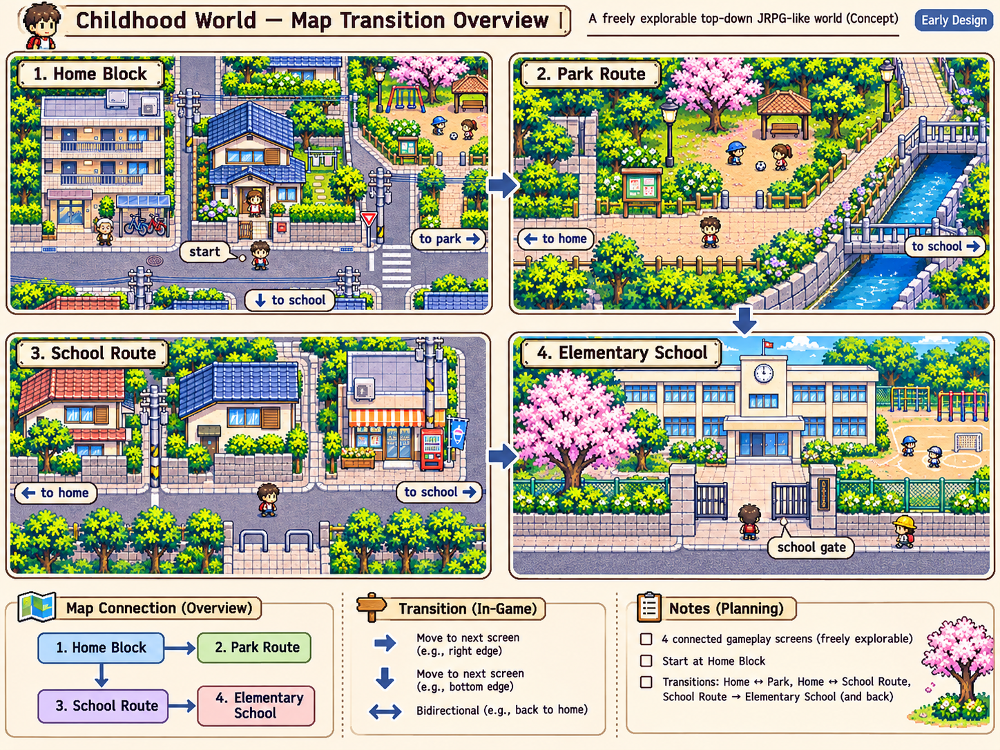
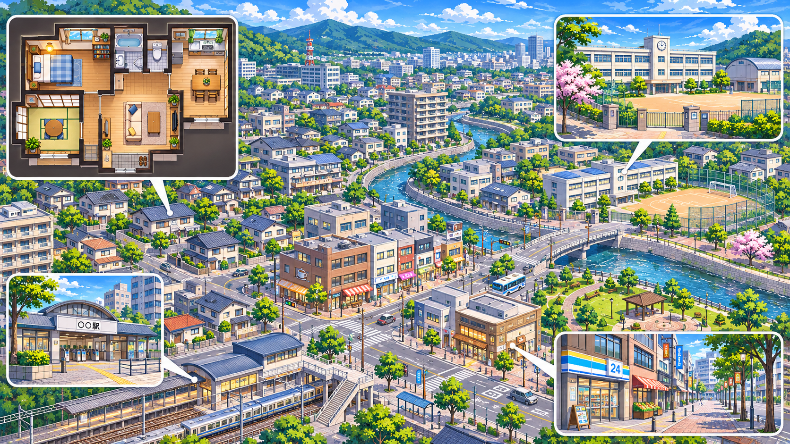

# マップ参考画像

2026年11月12日にユーザーから提供された、マップ設計のためのコンセプト画像です。ゲーム画面の構成・雰囲気を検討するために保管します。

## 幼少期の画面遷移案

自宅周辺、公園、通学路、小学校の4画面と、画面間を移動するイメージを示しています。

## 町全体のイメージ

住宅街、駅、学校、川、公園、商店、自宅内部などが共存する町の雰囲気を示しています。

これらはユーザー提供の生成コンセプト画像です。街区の位置関係、画面遷移、建物配置、縮尺、タイル構成が確定したことを意味しません。設計・実装要件は [マップと探索](../../../../docs/features/map.md) で管理します。関連する作業は [Issue #7](https://github.com/kame447/gmo-security-life-game/issues/7) を参照してください。
