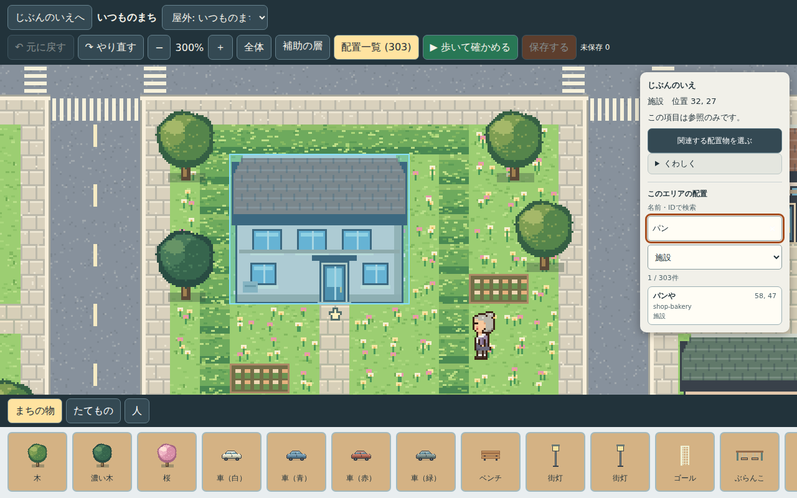
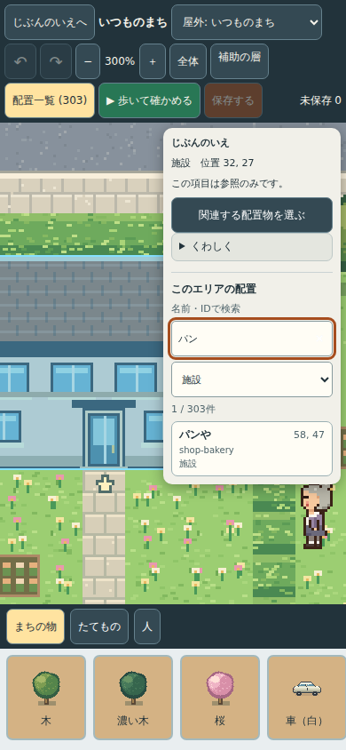
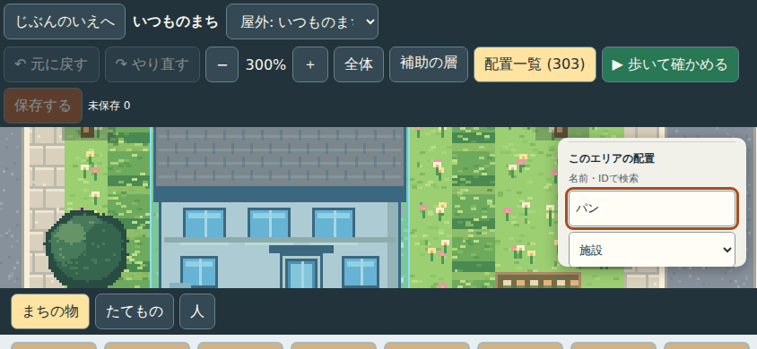

# 配置一覧の検索・種類フィルターの実画面

PR #82 の実装コミット `aabaeabc6a81428f3f6a806802b370172163056d` をブラウザで起動し、2026-11-20 の [GitHub Actions](https://github.com/kame447/gmo-security-life-game/actions/runs/44679775163/job/136100119824) で撮影した画面です。

追加した `e2e-world-editor-entity-list.mjs` は、この実装に対してPC・縦向き・横向きの計26項目が成功しました。検索と種類、未反映入力の維持、現在のエリアへの限定、変更の反映・Undo/Redo、参照情報、対象の位置、一覧下部から選んだ項目の編集欄の表示、パネル内スクロールの分離、保存リクエストが発生しないことを確認しています。PR全体の最新の検証状態は #82 のチェック欄と本文を参照してください。

画面では「じぶんのいえ」を参照したまま、「パン」の検索と「施設」の種類で一覧を絞っています。検索だけでは現在の選択と地図の位置を変えないため、検索結果は「パンや」、参照欄と地図は選択済みの家を表示しています。検索結果を選ぶと、その対象の位置と情報へ移ります。

## PC（1280×800）

## 縦向き（390×844）

## 横向き（844×390）

高さが小さい画面では、パネル内の縦スクロールで参照欄と検索結果を行き来します。利用者による操作と見た目の確認は #24・#25 の受け入れ条件に従って別途行います。
