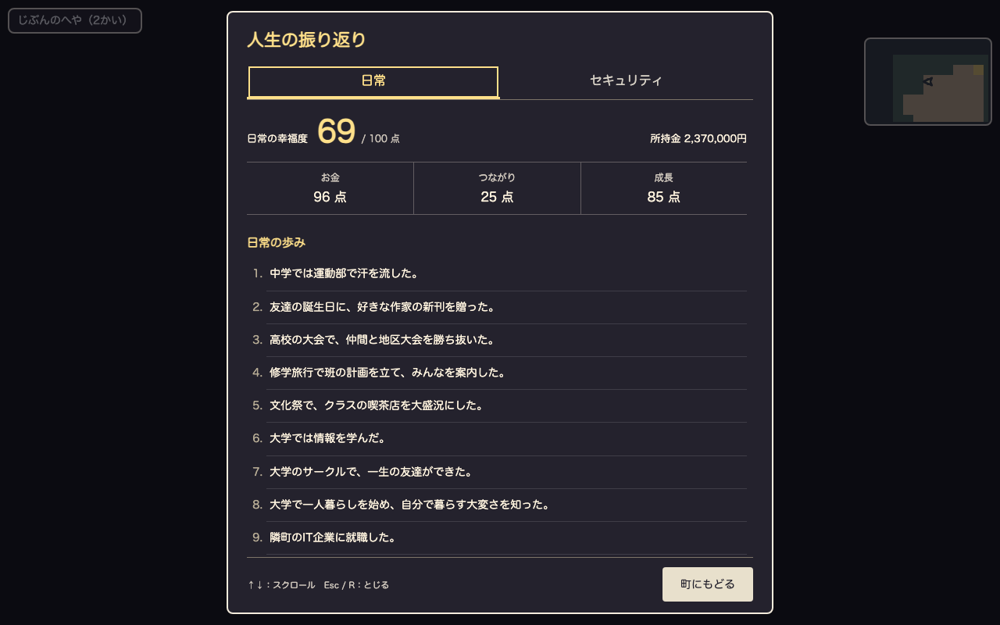
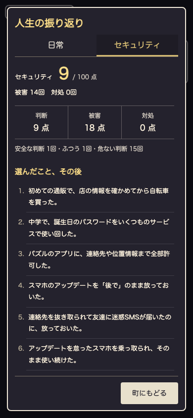
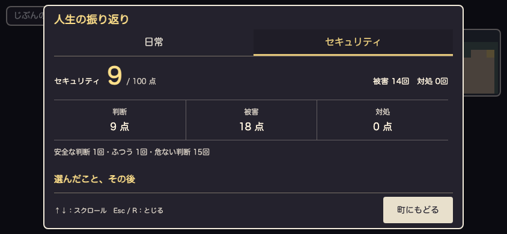

# 人生の振り返り画面の確認

2026-11-28の利用者指示に基づく作業。関連は [Issue #62](https://github.com/kame447/gmo-security-life-game/issues/62) と [Draft PR #90](https://github.com/kame447/gmo-security-life-game/pull/90)。実装済み・利用者レビュー待ちであり、確認前に main へマージしない。

## 実装内容

最後のステージでベッドから先へ進み、節目の会話を読み終えると、専用の「人生の振り返り」画面を開く。「日常」と「セキュリティ」のタブで、各軸の点数と3項目の内訳、選んだ出来事の全履歴を切り替える。日常には現在の所持金、セキュリティには被害と対処の回数も表示する。履歴はスクロールでき、「町にもどる」ボタンは画面の下部に残る。

「町にもどる」、Escape、R キーで閉じると探索に戻る。終了後は画面上部の「ふりかえり」ボタンまたは R キーで再表示できる。保存済みの `finished` から再開した場合は、最後の会話や結果画面を自動で再演しない。画面を開いている間は移動やスマホなどのゲーム操作を止め、Tab キーでフォーカスが画面の外へ移らないようにしている。

点数は `game/src/story/score.ts` の既存の計算式と仮値を使い、重みや満点の基準は変更していない。スコア自体を保存せず、保存した選択と現在の所持金から、画面を開くたびに再計算する。そのため終了後に買い物をした場合も、再表示時の所持金と日常のお金の評価へ反映する。終了時の所持金を固定する仕組みや保存形式の変更は加えていない。

## 手元での確認方法

リポジトリのルートから次のコマンドで起動する。

```sh
cd game
npm run dev -- --host 127.0.0.1 --port 5490 --strictPort
```

[ローカルの確認画面](http://127.0.0.1:5490/) を開き、最後のステージで必須イベントを終えて、自室のベッドから先へ進む。節目の会話の後に振り返り画面が開くことを確認する。日常とセキュリティを切り替え、長い履歴をスクロールしても「町にもどる」を押せることを確認する。タブにフォーカスがあるときは左右キーで切り替え、Tab キーでタブ・履歴・戻るボタンを移動できる。

画面を閉じた後は、「ふりかえり」ボタンと R キーで再表示する。再読み込み後も終了済みの状態が保たれ、自動で結果を開かずに同じ操作で再表示できることを確認する。終了後に買い物をしてから再表示すると、現在の所持金が反映される。

## 検証結果

専用の E2E は、最終節目直前の保存状態を準備してから、実際にベッドを調べて先へ進む選択をする。節目の会話後に `finished` の保存と結果表示が行われることを含め、デスクトップ 1280×800、縦画面 390×844、横画面 844×390、狭い画面 320×568 の4サイズで各6件、合計24件が成功した。

点数・内訳・全履歴が既存の評価計算と一致すること、画面と戻るボタンが表示領域に収まること、Tab キーでフォーカスが画面内に保たれることを確認した。表示中の移動・スマホ操作の遮断、長い履歴のスクロール、閉じてからの再表示、保存後の再読み込みも確認した。タッチ対応の3サイズでは指のドラッグに相当する入力でスクロールを確認し、ページエラーはなかった。

起動したサーバーを残し、別のターミナルでリポジトリのルートから次を実行すると、E2E と同フォルダの画像を再生成できる。E2E は独立したブラウザ環境を使う。

```sh
cd game
SLG_URL=http://127.0.0.1:5490 SLG_SHOTS=../docs/review/life-reflection node scripts/e2e-story-result.mjs
```

関連する単体テストは、終了時の流れ4件、結果画面3件、既存のストーリー13件、モーダル操作3件の合計23件が成功した。リポジトリのルートから次のコマンドで実行できる。

```sh
cd game
npx vitest run tests/story-result-flow.test.ts tests/story-result-panel.test.ts tests/story.test.ts tests/modal-panels.test.ts
```

型の検査と配置データの検証を含む `npm run build` も成功した。全体テストは、お使い・屋内表示の修正を合わせた確認用環境で別途実行する。

## 確認画像

デスクトップの日常画面。現在の所持金と3項目の内訳を、選択の履歴と並べて確認できる。



縦画面のセキュリティ画面。被害・対処の回数と履歴を表示し、下部に戻るボタンを残している。



高さの短い横画面。履歴部分をスクロールしながら、タブと戻るボタンを操作できる。


