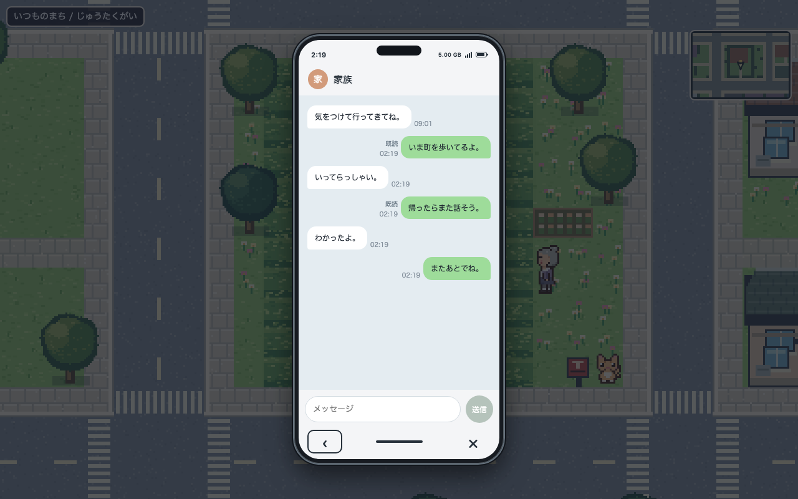
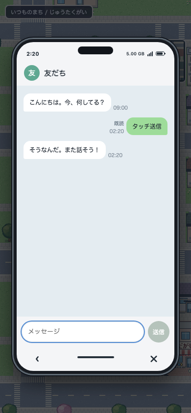

# メッセージの既読表示の確認

2026-11-28の利用者の追加指示に基づく作業。関連は [Issue #22](https://github.com/kame447/gmo-security-life-game/issues/22) と [Draft PR #91](https://github.com/kame447/gmo-security-life-game/pull/91)。実装・検証済みで、利用者による画面レビュー待ち。確認前に main へマージしない。

## 変更した動作

相手の返信が届いた時点で、その返信より前に送ったメッセージの時刻の上へ「既読」を表示する。返信前・返信なしの送信には表示しない。複数の送信があれば、返信までの送信にまとめて既読を付ける。受信の未読件数と、会話を開いたときに受信を既読へ変える動作は従来のままにしている。

表示は保存されている会話の並びから組み立てるため、新しい保存項目はない。返信が届く前に保存した場合は、従来の残り待ち時間から再開し、返信が届いた後に既読を付ける。固定返信を使い切った後など、返信がない送信には時間が経っても既読を付けない。詳しい規則は [メッセージの既読表示](../../features/phone-chat.md) を参照する。

チャット専用の描画とスタイルだけを変更し、PR #80 が編集中のスマホ共通モデル・共通画面・既存のスマホ仕様文書は変更していない。共有の機能索引には専用仕様への参照を1文追加した。

## 手元での確認方法

リポジトリのルートから次のコマンドで起動する。

```sh
cd game
npm run dev -- --host 127.0.0.1 --port 5493 --strictPort
```

[確認用のゲーム](http://127.0.0.1:5493/?review=1&skipOpening=1) を開き、スマホの「メッセージ」から相手を選んで送信する。送信直後には既読がなく、相手の固定返信が届くと既読になる。続けて送ったメッセージは、その後に返信が来るまで未表示になる。確認用 URL は既存のセーブを読み書きしない。通常保存からの再開は、後述の E2E が独立したブラウザ環境で確認する。

## 検証結果

関連する単体テストは4ファイル34件が成功した。新規の既読表示4件に加え、既存のチャットモデル11件、チャット保存12件、スマホの通信・チャット連携7件を確認した。表示処理が受信の未読状態を変えないこと、会話の順序と表示時刻が食い違っても順序で判定すること、保存後の返信待ち時間から再開できることを含む。

`npm run build` は、エディタデータの検証・型チェック・Vite のビルドまで成功した。全体テストは実行せず、関連範囲に絞って検証した。

`e2e-phone-chat.mjs` は成功した。PC 1280×800 では、返信前・返信後・返信なしの送信を区別し、通常保存と再読み込みの後も同じ既読表示になることを確認した。スマホ縦画面 390×844 ではタッチで送信し、返信後の既読が吹き出しの横へ収まることを確認した。既存の送受信、受信未読数、キー入力の隔離、文字列の安全な表示、スクロール、日本語 IME の入力維持も通った。外部への通信とページ・コンソールのエラーはなかった。

起動したサーバーを残し、別のターミナルの `game/` で次のコマンドを実行すると再確認できる。E2E は既存のユーザーセーブに触れず、同フォルダへ画像を出力する。

```sh
npx vitest run tests/phone-chat-receipts.test.ts tests/phone-chat.test.ts tests/phone-chat-save.test.ts tests/phone-data.test.ts --maxWorkers=1
npm run build
SLG_URL=http://127.0.0.1:5493 SLG_SHOTS=../docs/review/phone-chat-read node scripts/e2e-phone-chat.mjs
```

## 確認画像

PCで通常保存から再開した画面。返信があった2通には「既読」があり、返信のない最後の送信には付いていない。



スマホでタッチ送信し、相手の返信が届いた後の画面。既読と時刻を送信の吹き出しの横に並べている。


