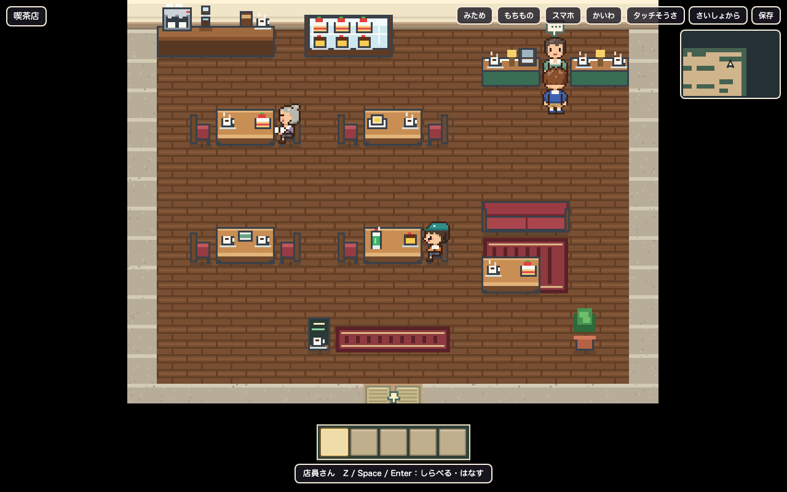
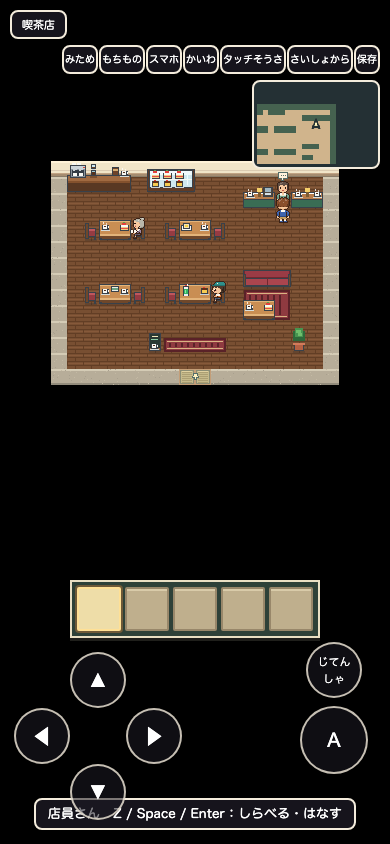

# 店内での客の過ごし方（Issue #33）

2026-11-28 の利用者承認済みの店内NPC変更です。コンビニ・八百屋・本屋・駄菓子屋・パン屋・薬局の客は商品棚を見る位置・向きに配置し、喫茶店の2名は椅子に座りテーブルを向きます。専用の座りポーズは静止し、既存の sprite ID と共存します。

買い物、所持金、イベント採点、通常保存、クラウドセーブを変更しません。任意イベントとの連携は別の未承認PRに残すため、ここでは既存の会話を表示します。

以下は統合試作（今回の変更に加えて未承認の他機能も含む）の実画面です。店舗内だけを撮影しています。

受け入れ条件は `game/tests/shop-customers.test.ts` に加え、NPCの描画、人物カタログと全ワールド回帰を実行してください。
