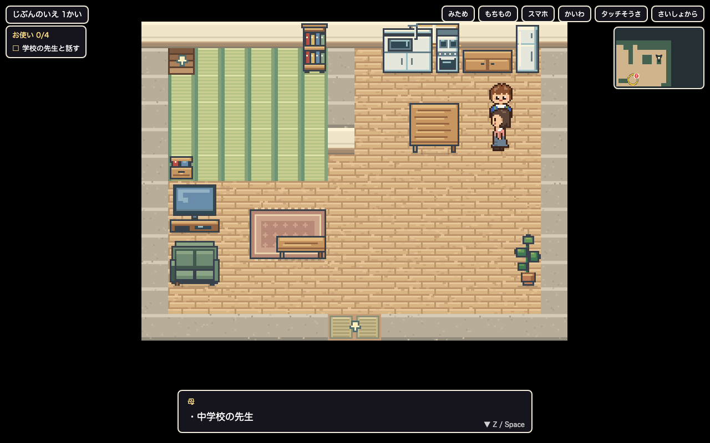
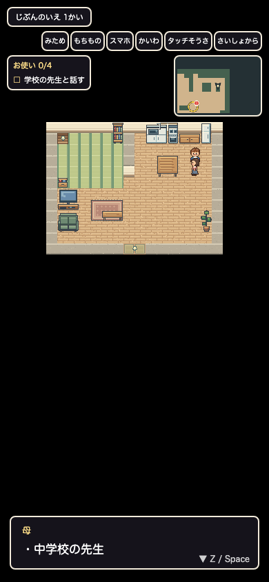

# お使い・目的地・屋内表示の確認

2026-11-28の利用者指示による [Draft PR #89](https://github.com/kame447/gmo-security-life-game/pull/89)。関連は [#15](https://github.com/kame447/gmo-security-life-game/issues/15)、[#20](https://github.com/kame447/gmo-security-life-game/issues/20)、[#85](https://github.com/kame447/gmo-security-life-game/issues/85)。実装済み・利用者レビュー待ち。確認前に main へマージしない。

## 実装と確認方法

お使いは、母親がそれぞれの行き先を話す台詞に合わせて一件ずつ縦に追加する。話しかけた直後の挨拶・スマホの受け渡し・依頼の導入ではまだ一覧を出さず、地図の印も説明済みの用事だけ出す。説明後と母親への再訪では全件を表示し、済んだ用事には同じ位置でチェックと取り消し線を残す。説明途中で保存して再開した場合も、全件を表示して達成済みのチェックを引き継ぐ。スマホの縦画面では、現在地とメニューの下、ミニマップの左に配置する。バッグなどの画面や大きい地図を開いている間は隠す。

目的地の印は、現在のエリアに相手がいる場合は実際の会話対象を指す。別のエリアなら、有効な出入口をたどり、最少のエリア移動で向かえる最初の入口・出口・階段を指す。母親への案内は1階、節目の案内は2階のベッドまで続く。相手や経路がなければ従来の施設位置を使う。施設の絵や名前、NPCと建物の配置は変えない。

屋内では持ち物欄の上までを描画範囲とし、出口と主人公が持ち物欄に隠れないようにする。横幅と拡大率を保ち、キャラクターの大きさは変えない。品名一行の高さも予約し、会話・バッグの開閉中も表示範囲を維持する。屋外へ戻ると全画面を使う。

ゲームを起動して「はじめから」を選び、母親に話しかける。挨拶中は一覧がなく、各用事の台詞で一覧と地図の印が一件ずつ増えることを確認する。学校へ入ると印が入口から先生へ変わり、話し終えると用事にチェックが残る。出口の前で持ち物欄と重ならないことと、バッグの開閉でカメラが動かないことを確認する。公園の友達・駅員・コンビニの店員への案内と、保存後の再開も確認対象とする。

## 検証結果

関連する単体テストは4ファイル・計40件が成功した。内訳は `story.test.ts` が13件、`minimap-targets.test.ts` が17件、`story-usability.test.ts` が7件、`playfield-viewport.test.ts` が3件。発話前の0件から台詞ごとの1〜4件への変化、同じ行を再観測しても増えないこと、会話終了・再訪・途中保存からの再開を確認した。型と配置データの検査を含む `npm run build` も成功した。

ブラウザ E2E は1280×800、390×844、844×390、320×568の4サイズと節目の確認で計25件が成功した。各サイズで、挨拶中は一覧が隠れ、用事の発話に合わせて一覧と地図の印が一件ずつ増えることを確認した。上部表示の非重複、キー・タッチ操作による会話完了、出口と主人公の見え方、拡大率の維持、バッグ開閉時のカメラ固定、保存復帰、母親とベッドへの案内も確認した。ページエラーは0件だった。独立確認では、バッグを開いたまま縦から横へ画面サイズを変更しても、閉じた後の表示範囲とカメラが変わらないことも確認した。

単体テストとビルドは、game ディレクトリで次のコマンドを実行する。単体テストの同時実行数は1にする。

```sh
npx vitest run tests/story-usability.test.ts tests/story.test.ts tests/minimap-targets.test.ts tests/playfield-viewport.test.ts --maxWorkers=1
npm run build
```

E2E の再実行では、game ディレクトリで開発サーバーを起動する。

```sh
npm run dev -- --host 127.0.0.1 --port 5489 --strictPort
```

別ターミナルの同じディレクトリで、次のコマンドを実行する。E2E は独立したブラウザ環境を使う。

```sh
SLG_URL=http://127.0.0.1:5489 SLG_SHOTS=../docs/review/story-playability node scripts/e2e-story-usability.mjs
```

## 確認画像

PCで母親が最初の行き先を話したところ。この時点では一件だけ表示する。



スマホの縦画面でも、同じ台詞に合わせて最初の一件を表示する。



同じ発話の[横画面](844x390-first-errand-dialog.png)と[幅320pxの縦画面](320x568-first-errand-dialog.png)も保存している。

説明が終わった後の一覧と目的地の印。


スマホの縦画面で学校の用事を終えたところ。


スマホの横画面でも拡大率を保つ。


