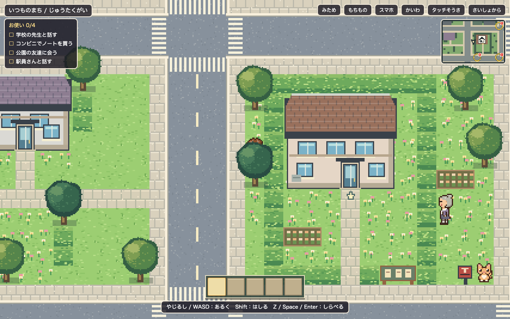
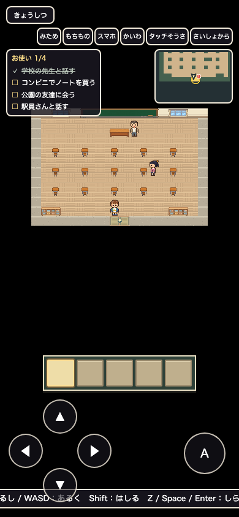
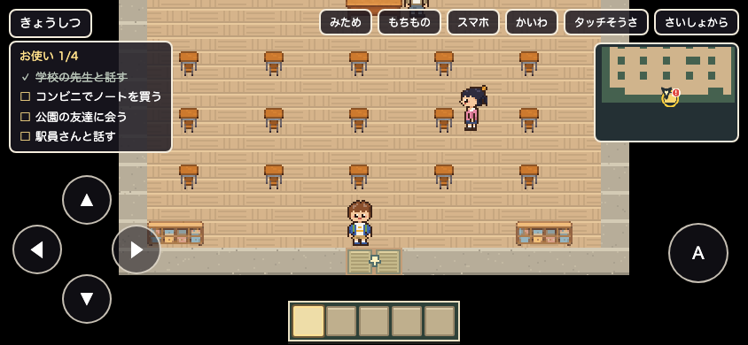

# お使い・目的地・屋内表示の確認

2026-11-28の利用者指示による [Draft PR #89](https://github.com/kame447/gmo-security-life-game/pull/89)。関連は [#15](https://github.com/kame447/gmo-security-life-game/issues/15)、[#20](https://github.com/kame447/gmo-security-life-game/issues/20)、[#85](https://github.com/kame447/gmo-security-life-game/issues/85)。実装済み・利用者レビュー待ち。確認前に main へマージしない。

## 実装と確認方法

お使いを一件ずつ縦に並べ、済んだ用事にも同じ位置でチェックと取り消し線を残す。スマホの縦画面では、現在地とメニューの下、ミニマップの左に配置する。会話中やほかの画面を開いている間は隠す。

目的地の印は、現在のエリアに相手がいる場合は実際の会話対象を指す。別のエリアなら、有効な出入口をたどり、最少のエリア移動で向かえる最初の入口・出口・階段を指す。母親への案内は1階、節目の案内は2階のベッドまで続く。相手や経路がなければ従来の施設位置を使う。施設の絵や名前、NPCと建物の配置は変えない。

屋内では持ち物欄の上までを描画範囲とし、出口と主人公が持ち物欄に隠れないようにする。横幅と拡大率を保ち、キャラクターの大きさは変えない。品名一行の高さも予約し、会話・バッグの開閉中も表示範囲を維持する。屋外へ戻ると全画面を使う。

ゲームを起動して「はじめから」を選び、母親からお使いを受ける。学校へ入ると印が入口から先生へ変わり、話し終えると用事にチェックが残る。出口の前で持ち物欄と重ならないことと、バッグの開閉でカメラが動かないことを確認する。公園の友達・駅員・コンビニの店員への案内と、保存後の再開も確認対象とする。

## 検証結果

地図と目的地の単体テスト30件、チェックリストと描画範囲の単体テスト6件が成功した。型と配置データの検査を含むビルドも成功した。

ブラウザ E2E は1280×800、390×844、844×390、320×568の4サイズと節目の確認で計21件が成功した。上部表示の非重複、キー・タッチ操作による会話完了、出口と主人公の見え方、拡大率の維持、バッグ開閉時のカメラ固定、保存復帰、母親とベッドへの案内を確認した。ページエラーは0件だった。独立確認では、バッグを開いたまま縦から横へ画面サイズを変更しても、閉じた後の表示範囲とカメラが変わらないことも確認した。

再実行は game ディレクトリで npm run dev -- --host 127.0.0.1 --port 5489 --strictPort を起動し、別ターミナルの同ディレクトリで SLG_URL=http://127.0.0.1:5489 SLG_SHOTS=../docs/review/story-playability node scripts/e2e-story-usability.mjs を実行する。E2Eは独立したブラウザ環境を使う。単体テストは npx vitest run tests/minimap*.test.ts tests/story-usability.test.ts tests/playfield-viewport.test.ts --maxWorkers=2、ビルドは npm run build で確認できる。

## 確認画像

町のお使い一覧と目的地の印。

スマホの縦画面で学校の用事を終えたところ。

スマホの横画面でも拡大率を保つ。

