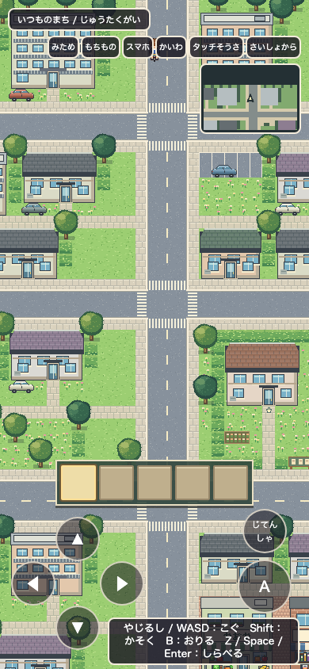
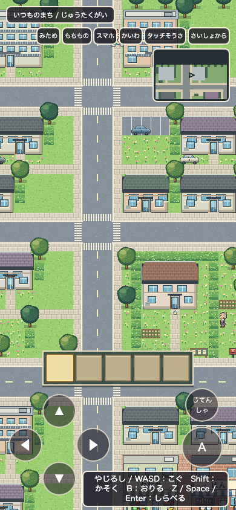
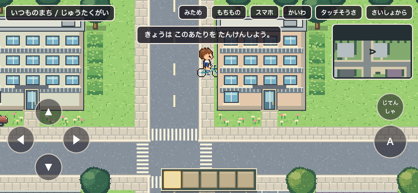
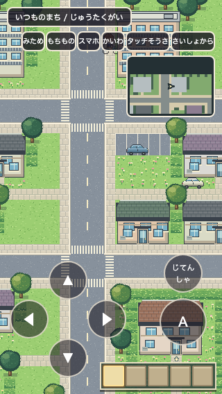

# タッチ操作での自転車加速 — Issue #66

実装はタッチの矢印を300ms長押しして加速する方式です。通常の自転車は176px/s、加速は240px/s、徒歩・PCのShift操作は変更しません。方向が変わったら300msを数え直し、全ての指が離れたら通常に戻します。会話、マップ以外のウィンドウ、降車、キャンセル、lostpointercaptureでも加速を解除します。

レビュー用：game ディレクトリから npm run dev を実行し、?review=1&skipOpening=1 で開いてください。Bキーで自転車に乗り、タッチ操作を表示して方向ボタンを長押しします。ブラウザの開発者ツールで幅を390x844、844x390、320x568にして比べられます。

下記は実際のChromiumで記録した画面です。正式な速度の数値は試作上の暫定値です。

関連テスト：game/tests/ui-controller.test.ts、game/scripts/e2e-bicycle-touch.mjs。通常の保存データを読み書きしないreviewモードで確認します。
